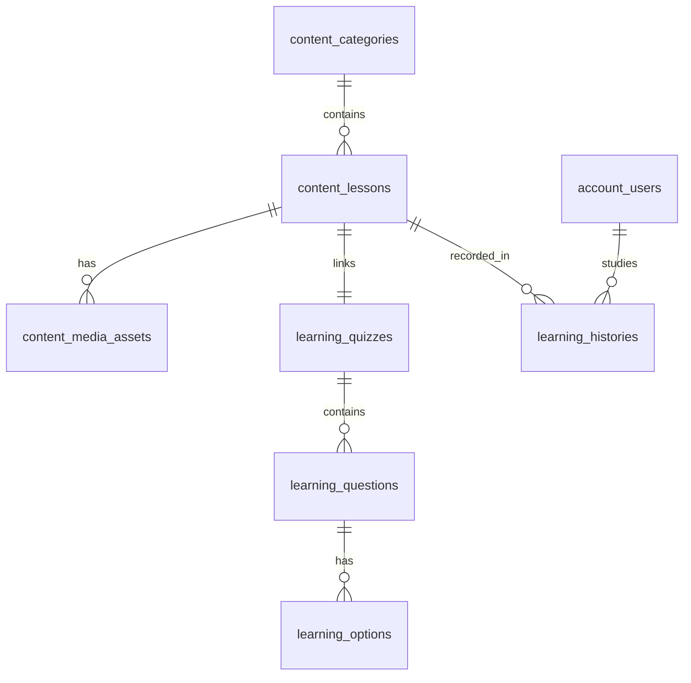

# Tài Liệu Đặc Tả Bounded Context: Content & Learning (M5 & M6)
**Dành riêng cho việc tích hợp:** Module M2 (Notification Service & Recommendation Lesson — Đạt phụ trách)  
**Tác giả:** Hà (Content Service & Learning Service)  
**Ngày cập nhật:** 09/11/2026  
**Trạng thái:** Đã chốt (Active Contract)

---

## 1. Phạm Vi Kiến Thức & Trắc Nghiệm Bài Học

### 1.1. Trắc nghiệm kiểm tra Từ vựng hay Ngữ pháp?
> **Hệ thống hỗ trợ cả TỪ VỰNG (Vocabulary) và NGỮ PHÁP (Grammar)** (cùng kỹ năng Nghe/Đọc cơ bản).

* **Theo chủ đề:** Bài học được tổ chức phân cấp theo **Danh mục (`content.categories`)**:
  * Nhóm ngữ pháp: *Thì Hiện tại đơn*, *Câu điều kiện*, *Mệnh đề quan hệ*,...
  * Nhóm từ vựng: *Từ vựng thói quen hàng ngày*, *Giao tiếp công sở*, *Từ vựng du lịch*, *IELTS / TOEIC Topic-based*,...
* **Theo bài học:** Mỗi bài học (`content.lessons`) chứa nội dung lý thuyết, ví dụ và file audio phát âm chuẩn.
* **Theo Quiz:** Mỗi bài học gắn liền với 1 bộ đề trắc nghiệm (`learning.quizzes` liên kết qua `lesson_id`). Câu hỏi trắc nghiệm sẽ bám sát trọng tâm của bài đó:
  * Bài ngữ pháp $\rightarrow$ Trắc nghiệm chọn dạng đúng của động từ, cấu trúc câu, sửa lỗi sai.
  * Bài từ vựng $\rightarrow$ Trắc nghiệm chọn nghĩa của từ, từ đồng nghĩa/trái nghĩa, điền từ vào câu theo ngữ cảnh.

### 1.2. Hướng dẫn thiết kế thuật toán Gợi ý (Recommendation Engine cho Đạt)
* Engine gợi ý bài học của Đạt **không cần phân tích sâu cấu trúc câu hỏi bên trong**, mà chỉ cần dựa trên:
  1. **`category_id`:** Chủ đề học viên đang theo đuổi hoặc điểm yếu cần khắc phục.
  2. **`level`:** Cấp độ bài học (`EASY` $\rightarrow$ `MEDIUM` $\rightarrow$ `HARD`).
  3. **`highest_score`:** Lịch sử điểm số (thang 0 – 100) từ bảng `learning.histories`.
  4. **Độ phổ biến:** Đếm số lượng học viên đã học bài đó từ `learning.histories`.

---

## 2. Đặc Tả Lược Đồ Database (Database Schema)

Toàn bộ dữ liệu nằm trên PostgreSQL (Supabase/Docker), tuân thủ nguyên tắc bounded context: **chỉ SELECT, không JOIN cross-schema.**



### 2.1. Schema `content` (Content Service — Của Hà)

#### Bảng `content.categories` (Danh mục bài học)
```sql
CREATE TABLE content.categories (
    id          UUID PRIMARY KEY DEFAULT gen_random_uuid(),
    name        TEXT NOT NULL,            -- Tên danh mục: "English Grammar", "Daily Vocabulary"...
    slug        TEXT NOT NULL,            -- URL-friendly slug: "english-grammar"
    parent_id   UUID,                     -- Danh mục cha (nếu có phân cấp)
    sort_order  INT DEFAULT 0,            -- Thứ tự sắp xếp hiển thị
    description TEXT
);
```

#### Bảng `content.lessons` (Bài học)
```sql
CREATE TABLE content.lessons (
    id                  UUID PRIMARY KEY DEFAULT gen_random_uuid(),
    category_id         UUID NOT NULL REFERENCES content.categories(id),
    title               TEXT NOT NULL,    -- Tiêu đề bài học
    body                TEXT,             -- Nội dung bài học (Markdown / Text)
    level               TEXT NOT NULL DEFAULT 'EASY' 
                        CHECK (level IN ('EASY', 'MEDIUM', 'HARD')),
    access              TEXT NOT NULL DEFAULT 'PUBLIC' 
                        CHECK (access IN ('PUBLIC', 'VIP')), -- Bài học thường vs bài học VIP
    status              TEXT NOT NULL DEFAULT 'DRAFT' 
                        CHECK (status IN ('DRAFT', 'PENDING', 'PUBLISHED', 'REJECTED')),
    deleted_at          TIMESTAMPTZ,
    created_at          TIMESTAMPTZ DEFAULT now(),
    updated_at          TIMESTAMPTZ DEFAULT now()
);

-- Index phục vụ query ứng viên cho Recommendation:
CREATE INDEX lessons_status_idx ON content.lessons (status) WHERE deleted_at IS NULL;
CREATE INDEX lessons_level_idx  ON content.lessons (level);
CREATE INDEX lessons_category_idx ON content.lessons (category_id);
```

#### Bảng `content.media_assets` (Ảnh và Audio bài học)
```sql
CREATE TABLE content.media_assets (
    id          UUID PRIMARY KEY DEFAULT gen_random_uuid(),
    lesson_id   UUID NOT NULL,
    kind        TEXT NOT NULL CHECK (kind IN ('IMAGE', 'AUDIO', 'VIDEO')),
    cdn_url     TEXT NOT NULL,            -- Đường dẫn Cloudinary / CDN
    bytes       BIGINT DEFAULT 0,
    created_at  TIMESTAMPTZ DEFAULT now()
);
```

---

### 2.2. Schema `learning` (Learning Service — Của Hà)

#### Bảng `learning.quizzes` (Bộ câu hỏi theo bài học)
```sql
CREATE TABLE learning.quizzes (
    id          UUID PRIMARY KEY DEFAULT gen_random_uuid(),
    lesson_id   UUID NOT NULL,            -- Logical FK trỏ sang content.lessons(id)
    title       TEXT NOT NULL,            -- Tiêu đề Quiz
    created_at  TIMESTAMPTZ DEFAULT now()
);
CREATE INDEX quizzes_lesson_idx ON learning.quizzes (lesson_id);
```

#### Bảng `learning.questions` & `learning.options` (Câu hỏi & Lựa chọn)
```sql
CREATE TABLE learning.questions (
    id          UUID PRIMARY KEY DEFAULT gen_random_uuid(),
    quiz_id     UUID NOT NULL REFERENCES learning.quizzes(id) ON DELETE CASCADE,
    content     TEXT NOT NULL,            -- Nội dung câu hỏi (ngữ pháp / từ vựng)
    type        TEXT NOT NULL DEFAULT 'SINGLE_CHOICE'
                CHECK (type IN ('SINGLE_CHOICE', 'MULTI_CHOICE'))
);

CREATE TABLE learning.options (
    id          UUID PRIMARY KEY DEFAULT gen_random_uuid(),
    question_id UUID NOT NULL REFERENCES learning.questions(id) ON DELETE CASCADE,
    content     TEXT NOT NULL,            -- Nội dung đáp án A, B, C, D
    is_correct  BOOLEAN NOT NULL DEFAULT FALSE -- Ẩn với học viên, chỉ dùng để chấm điểm
);
```

#### Bảng `learning.histories` (Lịch sử làm bài — Quan trọng nhất cho Đạt)
```sql
CREATE TABLE learning.histories (
    id            UUID PRIMARY KEY DEFAULT gen_random_uuid(),
    user_id       UUID NOT NULL,          -- Logical FK trỏ sang account.users(id)
    lesson_id     UUID NOT NULL,          -- Logical FK trỏ sang content.lessons(id)
    highest_score DOUBLE PRECISION NOT NULL DEFAULT 0, -- Thang điểm chuẩn: 0 - 100
    completed_at  TIMESTAMPTZ NOT NULL DEFAULT now(),  -- Thời gian nộp bài gần nhất
    CONSTRAINT histories_user_lesson_key UNIQUE (user_id, lesson_id)
);
CREATE INDEX histories_user_idx ON learning.histories (user_id);
CREATE INDEX histories_completed_at_idx ON learning.histories (completed_at);
```

---

## 3. Các Điểm Cam Kết & Chốt Kỹ Thuật (Contract Agreement)

| Vấn đề | Quyết định đã chốt | Tác động tới Module M2 của Đạt |
| :--- | :--- | :--- |
| **Thang điểm `highest_score`** | **0 – 100 điểm** (không dùng thang 0 – 10) | Ngưỡng gợi ý của Đạt: `RECO_PROMOTE_SCORE = 80` (lên cấp khó hơn), `RECO_REVIEW_SCORE = 50` (cần ôn lại). |
| **Cập nhật `completed_at`** | **Luôn cập nhật `completed_at = now()` ở mọi lần nộp bài** (kể cả khi điểm không cao hơn điểm cũ). | Đảm bảo Cron nhắc học lúc 20:00 hằng ngày (`study-reminder-cron`) lọc chính xác học viên chưa học trong ngày. |
| **Phân quyền bài học VIP** | Cột `access = 'VIP'` trong `content.lessons`. | Nếu `X-User-Tier` là `normal` / `guest`, thuật toán của Đạt lọc `is_free = true` (hoặc `access = 'PUBLIC'`). |
| **Trạng thái bài học** | Chỉ gợi ý bài có `status = 'PUBLISHED'` và `deleted_at IS NULL`. | Loại bỏ bài nháp (`DRAFT`) hoặc bài bị từ chối (`REJECTED`). |

---

## 4. Dữ Liệu Mẫu Chuẩn Để Ingest (Sample JSON Seed Data)

Dưới đây là 1 gói dữ liệu mẫu hoàn chỉnh (bao gồm 1 bài học chuẩn + đề thi trắc nghiệm kết hợp cả Từ vựng và Ngữ pháp):

```json
{
  "category": {
    "name": "Thì Hiện Tại Đơn & Đời Sống Hằng Ngày",
    "slug": "present-simple-daily-life",
    "description": "Nắm vững ngữ pháp thì hiện tại đơn kết hợp từ vựng về thói quen sinh hoạt mỗi ngày."
  },
  "lesson": {
    "title": "Unit 1: Present Simple Tense & Daily Routines",
    "level": "EASY",
    "access": "PUBLIC",
    "status": "PUBLISHED",
    "body": "## 1. Ngữ Pháp Trọng Tâm: Thì Hiện Tại Đơn\n\n### Cấu trúc khẳng định:\n- **Chủ ngữ số nhiều / I, You, We, They:** S + V (nguyên mẫu) + O\n  * *Ví dụ:* I wake up at 6:00 AM every day.\n- **Chủ ngữ số ít / He, She, It:** S + V(s/es) + O\n  * *Ví dụ:* She brushes her teeth every morning.\n\n### Cấu trúc phủ định:\n- S + do/does + not + V (nguyên mẫu)\n  * *Ví dụ:* He doesn't drink coffee.\n\n---\n\n## 2. Từ Vựng Chủ Đề: Thói Quen Hằng Ngày\n- **Wake up** (v): Thức dậy\n- **Brush teeth** (v): Đánh răng\n- **Have breakfast** (v): Ăn sáng\n- **Commute** (v): Đi làm / Đi học\n- **Routine** (n): Thói quen thường nhật",
    "audio_url": "https://res.cloudinary.com/demo/video/upload/sample_audio_unit1.mp3"
  },
  "quiz": {
    "title": "Bài Kiểm Tra Trắc Nghiệm: Unit 1",
    "questions": [
      {
        "id_ref": "Q1_GRAMMAR",
        "content": "She ___ to school by bicycle every morning.",
        "type": "SINGLE_CHOICE",
        "category_focus": "GRAMMAR",
        "options": [
          { "content": "go", "is_correct": false },
          { "content": "goes", "is_correct": true },
          { "content": "going", "is_correct": false },
          { "content": "went", "is_correct": false }
        ]
      },
      {
        "id_ref": "Q2_VOCABULARY",
        "content": "Which word means 'the usual series of things that you do at a particular time'?",
        "type": "SINGLE_CHOICE",
        "category_focus": "VOCABULARY",
        "options": [
          { "content": "Routine", "is_correct": true },
          { "content": "Commute", "is_correct": false },
          { "content": "Breakfast", "is_correct": false },
          { "content": "Brush", "is_correct": false }
        ]
      },
      {
        "id_ref": "Q3_GRAMMAR_MULTI",
        "content": "Select ALL grammatically correct sentences (Chọn tất cả các câu đúng ngữ pháp):",
        "type": "MULTI_CHOICE",
        "category_focus": "GRAMMAR",
        "options": [
          { "content": "They plays football on weekends.", "is_correct": false },
          { "content": "They play football on weekends.", "is_correct": true },
          { "content": "Does he like English?", "is_correct": true },
          { "content": "Does he likes English?", "is_correct": false }
        ]
      },
      {
        "id_ref": "Q4_VOCABULARY_CONTEXT",
        "content": "Don't forget to ___ your teeth before going to bed.",
        "type": "SINGLE_CHOICE",
        "category_focus": "VOCABULARY",
        "options": [
          { "content": "wake", "is_correct": false },
          { "content": "brush", "is_correct": true },
          { "content": "make", "is_correct": false },
          { "content": "have", "is_correct": false }
        ]
      }
    ]
  }
}
```

---

## 5. API Nội Bộ (Internal Endpoints) Phục Vụ Module M2

Khi Đạt chuyển từ direct SQL (`reco-readers.py`) sang gọi HTTP API nội bộ theo chuẩn Microservices, các endpoint sau của Hà đã sẵn sàng phục vụ:

| Endpoint | Method | Trả về | Mục đích sử dụng |
| :--- | :---: | :--- | :--- |
| `/api/v1/learning/last-activity` | `GET` | Timestamp học gần nhất của user | Phục vụ cron 20:00 của Notification Service |
| `/api/v1/lessons` | `GET` | Danh sách bài học kèm level, access, status | Phục vụ lấy danh sách ứng viên (candidate lessons) |
| `/api/v1/lessons/{id}` | `GET` | Chi tiết bài học | Lấy thông tin bài học được gợi ý |
| `/api/v1/quizzes/lesson/{lesson_id}` | `GET` | Bộ quiz của bài học | Kiểm tra bài học có quiz hay không |
| `/api/v1/learning/me/attempts` | `GET` | Lịch sử điểm của user hiện tại | Phục vụ engine cá nhân hóa gợi ý bài học |
